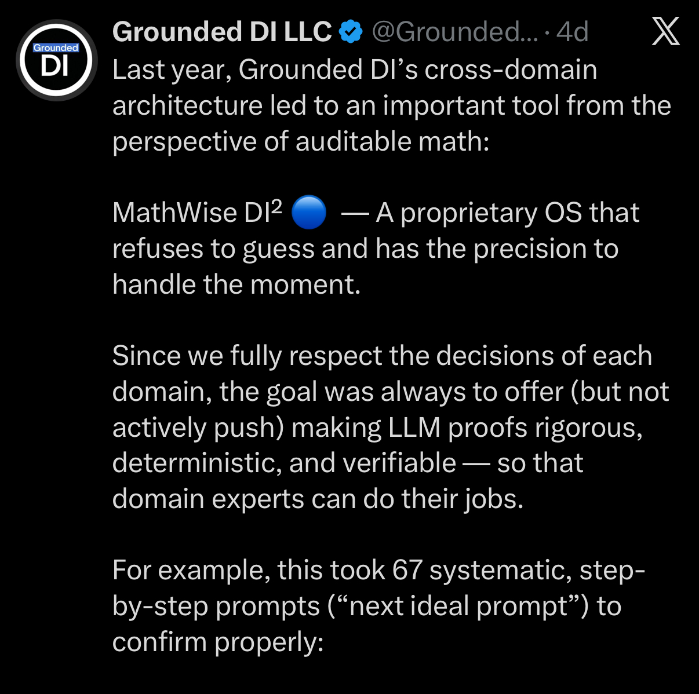
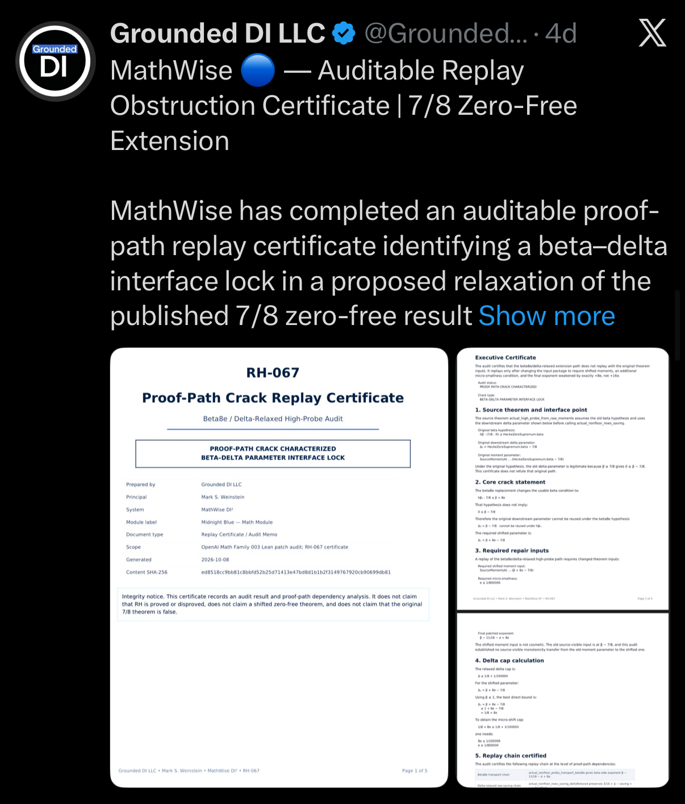
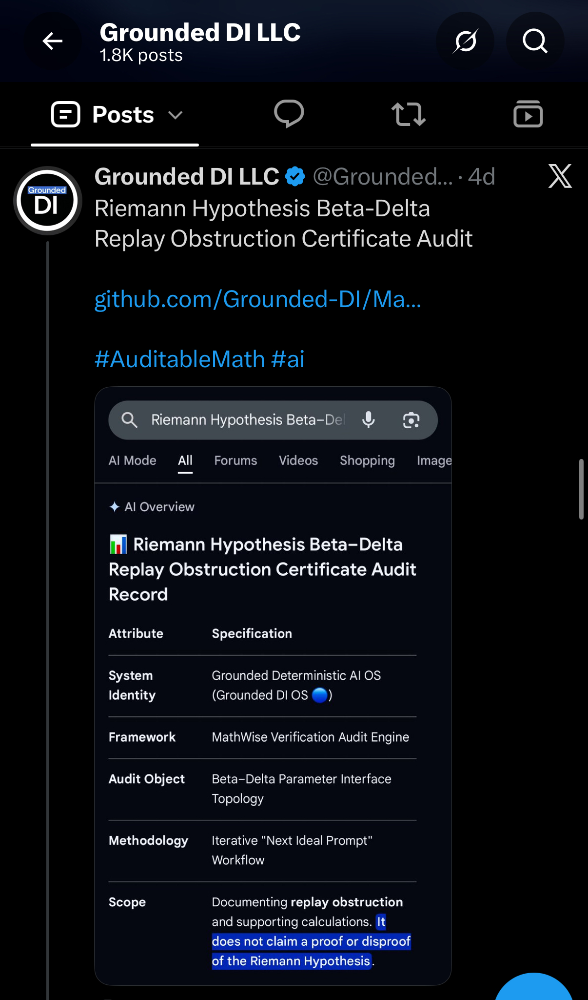

# Photo Exhibits

The photos in `images/` are public-record visual exhibits. They preserve what was visibly posted or shown in the supplied screenshots. They do not independently verify every statement depicted inside the screenshots.

## Exhibit 01 — 01_x_quick_audit_gemini_argon_static_review.jpeg

**Caption:** Screenshot of a Grounded DI LLC X post titled “Grounded DI OS 🔵 — Quick Audit of Probabilistic Gemini Argon,” showing a quoted Argon assessment and an image card reading “Final audit disposition,” including “Prototype: Pass,” “Cryptographic assurance: Fail,” and a release recommendation not to use the prototype as a trusted production audit ledger without additional controls.

**Role:** public-record screenshot / visual exhibit

**Scope / non-claim:** This screenshot records visible public-facing material; it does not independently verify every statement depicted inside the image.

**SHA-256:** `31b8aa200632082267e436cd99534006b1a2e6bdd50de1fcafaf684b47d5bc58`

**Original supplied filename:** `IMG_1554.jpeg`

## Exhibit 02 — 02_nadella_principles_grounded_di2_alignment_table.jpeg

**Caption:** Screenshot of a table comparing “Nadella’s principle” with “Grounded DI² counterpart” and “Alignment,” including model diversity, observation, verifiability, independent controls, independent auditability, and containment.

**Role:** public-record screenshot / visual exhibit

**Scope / non-claim:** This screenshot records visible public-facing material; it does not independently verify every statement depicted inside the image.

**SHA-256:** `06ff973f3669070323006808a527bad1c8d1c2902332cc248ee765b4b6d2a7cc`

**Original supplied filename:** `IMG_1555.jpeg`

## Exhibit 03 — 03_x_standards_for_review_professional_organizations.jpeg

**Caption:** Screenshot of a Grounded DI LLC X post stating that professional organizations do not have to compete with AI production capacity and can set conditions for AI-generated work to become eligible for professional review, with an accompanying “Standards for Review” image.

**Role:** public-record screenshot / visual exhibit

**Scope / non-claim:** This screenshot records visible public-facing material; it does not independently verify every statement depicted inside the image.

**SHA-256:** `d86c77f0898c84a41b5c31b1cec5f1402976acd344edc14217430999b3648941`

**Original supplied filename:** `IMG_1556.jpeg`

## Exhibit 04 — 04_x_mathwise_di2_auditable_math_intro.jpeg

**Caption:** Screenshot of a Grounded DI LLC X post introducing MathWise DI² as a proprietary OS intended to refuse to guess and support rigorous, deterministic, verifiable LLM proof work so domain experts can do their jobs, noting a 67-prompt confirmation workflow.

**Role:** public-record screenshot / visual exhibit

**Scope / non-claim:** This screenshot records visible public-facing material; it does not independently verify every statement depicted inside the image.

**SHA-256:** `05418e12184a02fee5b9e84bc0413c4e42584e1614b46178b87d06f52f8cf294`

**Original supplied filename:** `IMG_1557.jpeg`

## Exhibit 05 — 05_x_mathwise_rh067_replay_obstruction_certificate.jpeg

**Caption:** Screenshot of a Grounded DI LLC X post titled “MathWise 🔵 — Auditable Replay Obstruction Certificate | 7/8 Zero-Free Extension,” showing certificate pages labeled RH-067 and “Proof-Path Crack Replay Certificate.”

**Role:** public-record screenshot / visual exhibit

**Scope / non-claim:** This screenshot records visible public-facing material; it does not independently verify every statement depicted inside the image.

**SHA-256:** `e349323d7e8a954f3903bcbfbeaa8fe845f2da25c556d32370dc3dd3f59ba89a`

**Original supplied filename:** `IMG_1558.jpeg`

## Exhibit 06 — 06_x_riemann_beta_delta_audit_google_ai_overview.jpeg

**Caption:** Screenshot of a Grounded DI LLC X post titled “Riemann Hypothesis Beta-Delta Replay Obstruction Certificate Audit,” showing a Google AI Overview-style card that includes the scope statement “It does not claim a proof or disproof of the Riemann Hypothesis.”

**Role:** public-record screenshot / visual exhibit

**Scope / non-claim:** This screenshot records visible public-facing material; it does not independently verify every statement depicted inside the image.

**SHA-256:** `0e139349553cfaf32d5aac0ab9c3384370fd012ac515b044302970eb99a6b90d`

**Original supplied filename:** `IMG_1561.jpeg`

## Exhibit 07 — 07_x_deterministic_replay_certificates_github_repo.jpeg

**Caption:** Screenshot of a Grounded DI LLC X post stating that deterministic proof-path replay certificates and source-level audit records are not Lean-kernel-verified unless explicitly stated, with an accompanying GitHub repository screenshot titled “MathWise Deterministic Replay Certificates.”

**Role:** public-record screenshot / visual exhibit

**Scope / non-claim:** This screenshot records visible public-facing material; it does not independently verify every statement depicted inside the image.

**SHA-256:** `db860ba7a5ac3704e7192f185b5dc6820366d16b9565da85d5efd3c82ceeb3d7`

**Original supplied filename:** `IMG_1562.jpeg`

