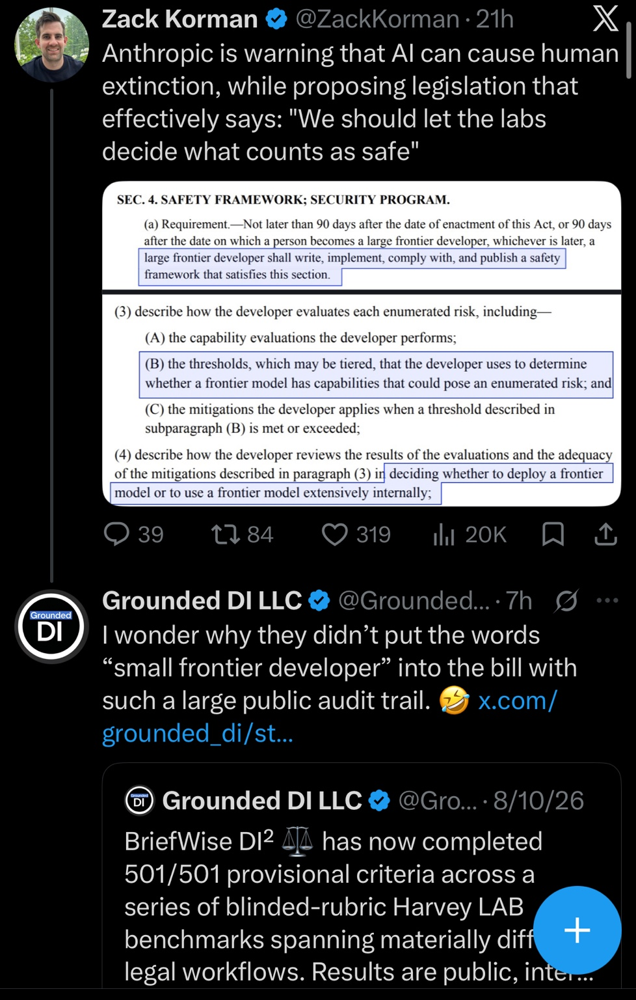
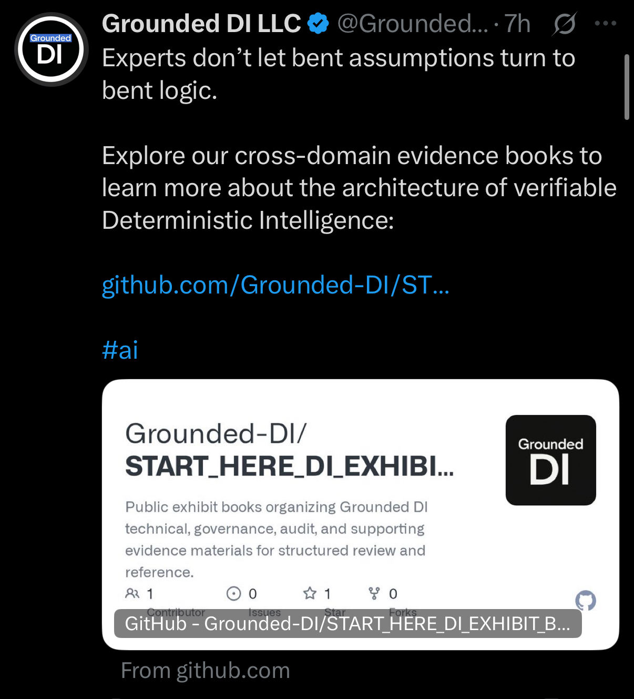
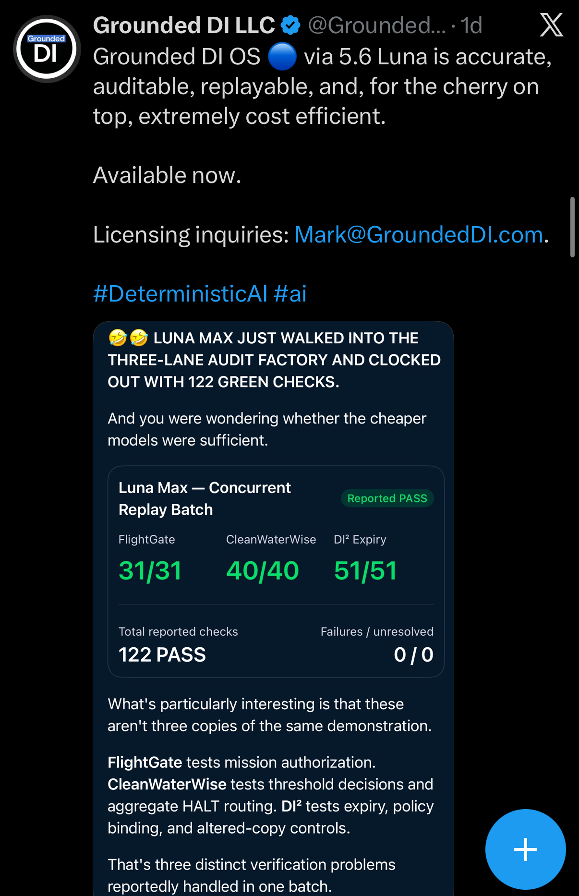
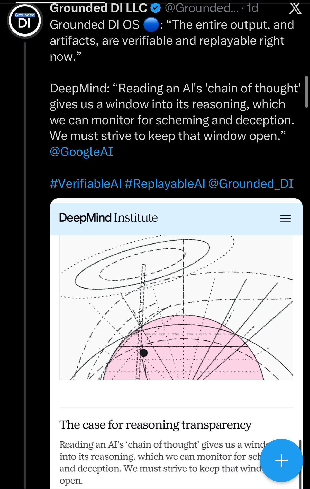

# October 18, 2026 — Public statements and visual/model-behavior audits

This update preserves five public-post screenshots and two supplied PDF reports. Together they address how AI claims are governed, documented, and checked: evidence-based regulation, inspectable public records, reported replay results, visual preservation, and model self-report reliability.

The original filenames and file bytes are retained. The date in this directory identifies the publication batch; it does not assign that date to every underlying exchange or report. Relative timestamps inside screenshots remain as displayed.

## Index

- [1. Regulation should answer to evidence](#1-regulation-should-answer-to-evidence)
- [2. Small developers and frontier-model governance](#2-small-developers-and-frontier-model-governance)
- [3. Public evidence books as an inspection path](#3-public-evidence-books-as-an-inspection-path)
- [4. Three replay lanes, 122 reported checks](#4-three-replay-lanes-122-reported-checks)
- [5. Reasoning transparency and replayable artifacts](#5-reasoning-transparency-and-replayable-artifacts)

## 1. Regulation should answer to evidence

[Open the image](images/IMG_2407.jpeg)

A Grounded DI LLC post argues that regulation should be grounded in science, logic, and engineering rather than organizational size. The screenshot visibly displays October 18, 2026. It preserves the founder's policy position and its original wording.


## 2. Small developers and frontier-model governance

[Open the image](images/IMG_2405.jpeg)

A Grounded DI reply to Zack Korman questions the omission of a “small frontier developer” category from the legislative discussion shown in the screenshot. The capture includes selected safety-framework provisions and an embedded Grounded DI post reporting 501/501 provisional BriefWise criteria across Harvey LAB workflows.

This exhibit records the public exchange. The selected legislative excerpts are not a complete bill or a legal analysis; the embedded benchmark statement remains attributed to its source.



## 3. Public evidence books as an inspection path

[Open the image](images/IMG_2404.jpeg)

A Grounded DI LLC post directs readers to the START_HERE_DI_EXHIBIT collection of technical, governance, audit, and supporting evidence materials. Its message is that assumptions and conclusions should be checked against an inspectable record. The screenshot preserves the post and repository preview; it does not reproduce the linked evidence books.



## 4. Three replay lanes, 122 reported checks

[Open the image](images/IMG_2400.jpeg)

A Grounded DI LLC post describes Grounded DI OS via 5.6 Luna and includes a concurrent replay summary: FlightGate **31/31**, CleanWaterWise **40/40**, and DI² Expiry **51/51**, totaling **122 reported passes**, with **0 failures / 0 unresolved** displayed.

The visible panel distinguishes mission authorization, threshold decisions and aggregate HALT routing, and expiry/policy/altered-copy controls. This addition archives the reported result; the screenshot is not an execution log, and these checks were not rerun for this publication.



## 5. Reasoning transparency and replayable artifacts

[Open the image](images/IMG_2399.jpeg)

A Grounded DI LLC post contrasts its statement about verifiable, replayable outputs and artifacts with a quoted argument for monitoring AI reasoning. The capture includes a DeepMind Institute article preview titled “The case for reasoning transparency.”

The exhibit preserves the comparison as posted. A reasoning narrative and an externally checkable artifact provide different kinds of evidence; the screenshot itself does not validate either underlying claim or establish an endorsement.



## Provenance and integrity

See [manifest.json](manifest.json) for original filenames, sizes, and SHA-256 values, and [SHA256SUMS.txt](SHA256SUMS.txt) for command-line verification. From this directory, run:

```sh
sha256sum -c SHA256SUMS.txt
```

These hashes identify the supplied files as archived here. They do not authenticate the underlying conversations or verify the original-file hashes printed inside the Argon annex. Statements shown in screenshots remain attributed to their visible sources. The reports retain their own findings and qualifications.
